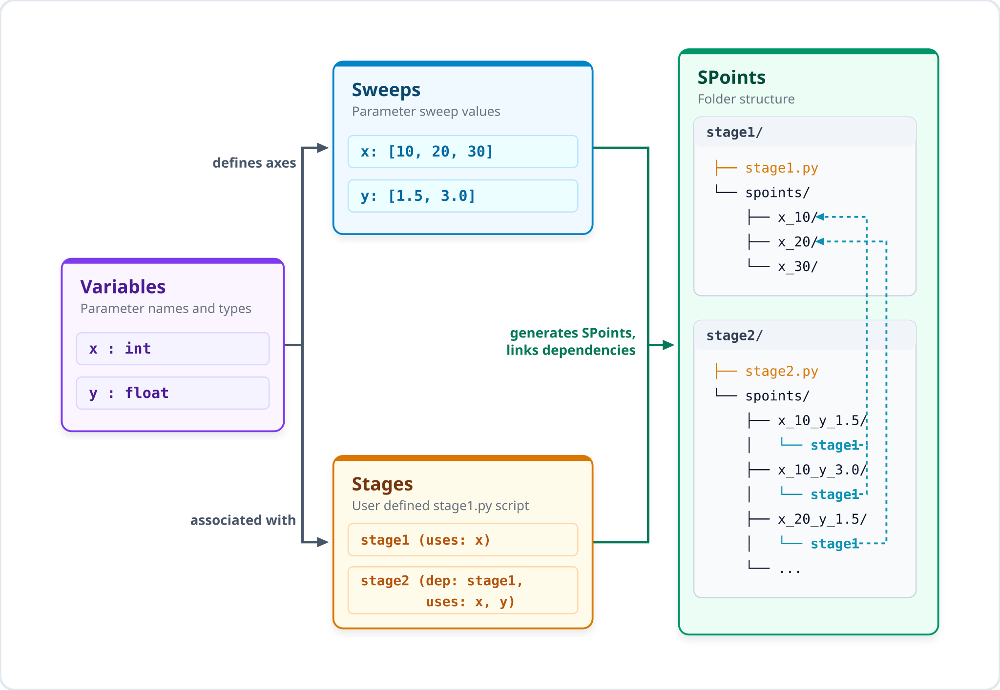

# snap_workflow

A Python-based parametric workflow manager for running large-scale computational experiments on workstations and HPC clusters. Define simulation stages, sweep across parameter combinations, and submit jobs to Slurm or run workstation auto-scheduling — all from a single command-line interface.



## Features

### Ease of Use
- **Simple Workspace Layout** — Flat directories with user scripts (`{stage}.py`, `collect.py`) keep code clean and organized.
- **Easy Parameter Sweeps** — Enter variables and automatically generate all sweep combinations in the workspace.
- **Interactive State Tracking** — Makes it easy to track SPoints: which are complete, currently working, hit errors, or stopped.
- **Timeout State Management** — Define custom Python functions to automatically save simulation progress when a timeout or signal interrupt occurs, enabling seamless checkpoint recovery.
- **Stage Dependencies & Linking** — Automatically link and execute stages in their dependency order.
- **Automatic Shell Autocomplete** — Command and parameter tab-completion makes running sweeps intuitive.

### Data Locality & Resource Optimization
- **Smart Scheduling & Data Locality** — Keeps computations on the systems containing the required parent data (> 1 GB), avoiding slow network transfers.
- **Dynamic Resource Packing & GPU Isolation** — Packs multiple concurrent SPoints on your workstation automatically based on CPU, GPU, and Memory limits.

### HPC Cluster & Customization
- **Flexible Execution Models** — Run jobs directly on your system, start persistent worker allocations, or trigger unified auto-scheduling.
- **Node-Specific Environment Profiles** — Configure Python environments, environment variables, or package formats dynamically (JSON/YAML support).
- **Remote Node Deployment** — Setup remote systems easily, keeping node-specific configurations clean.

## Installation

```bash
git clone https://github.com/tanner/snap_workflow.git
cd snap_workflow
pip install -e .
```

This installs the `workflow` command-line tool and the `snap_workflow` Python package.

### Shell Tab Completion

To enable tab completion for command subcommands, stage names, sweep names, profiles, and remotes:

**For Bash:**
Add the following line to your `~/.bashrc`:
```bash
eval "$(_WORKFLOW_COMPLETE=bash_source workflow)"
```

**For Zsh:**
Add the following line to your `~/.zshrc`:
```zsh
eval "$(_WORKFLOW_COMPLETE=zsh_source workflow)"
```

Or run `workflow autocomplete [bash|zsh]` for on-demand instructions.

### Requirements

- Python ≥ 3.8
- PyYAML (optional, required if using YAML format preferences)

## Quick Start

### 1. Initialize a workflow

```bash
mkdir my_experiment && cd my_experiment
workflow init
```

This prompts you to select your preferred configuration format (`json` or `yaml`) and creates the workspace structure:

```
my_experiment/
├── .workflow/          # System metadata (stages, sweeps, workers, spoint.sh)
├── params/             # Define workflow parameters available in all stages
└── workers/            # Slurm worker profiles (cpu.json/yaml, gpu.json/yaml)
```

### 2. Add variables

While params are static for the whole workflow, variables represent parameters whose values you want to sweep/vary over during computational experiments. Add them via:
```bash
workflow variable add
```

Follow the interactive prompts to register variable names and types (e.g., `mesh_size: int`, `reynolds_number: float`).

### 3. Add stages

A stage is a distinct step or task in your computational pipeline (e.g. mesh generation, numerical solving, rendering, etc.). Add a stage via:
```bash
workflow stage add
```

During stage creation, the system prompts you to declare any upstream dependencies. snap_workflow automatically creates soft links to the appropriate dependent SPoint directory inside your stage runner directory, letting you reference parent outputs easily. Each stage creates a directory with flat template files:

```
my_stage/
├── my_stage.py     # Write your simulation script here
├── collect.py      # Specify which data you want to collect
├── env.json        # Specify runtime environment requirements
└── spoints/        # snap_workflow auto-generates and runs SPoints specified in Sweeps
```

### 4. Write your simulation script

Edit `my_stage/my_stage.py`:

```python
from snap_workflow import SPointManager

with SPointManager() as sm:
    import numpy as np
    
    # Define a function to automatically save progress state on timeout or signal interrupt
    def save_progress():
        print("Saving checkpoint progress before timeout...")
        np.save("state.npy", current_state)  # Note: current_state must be defined in your computation loop below
        
    # Register the save function with the SPointManager instance
    sm.set_save_func(save_progress)
    
    params = sm.load_params()

    # Read sweep variables from the variables container
    mesh_size = params["variables", "mesh_size"]

    # Load upstream/dependent stage data via automatically linked directory
    parent_data = np.load("dependent_stage/data.npy")

    # ... run computation ...
```

### 5. Add a sweep

A sweep defines the values you want your variables to take across your registered stages. Add a sweep via:
```bash
workflow sweep add
```

Define which stages to include and what variable values to sweep over. snap_workflow generates all SPoints as subdirectories under each stage's `spoints/` folder.

### 6. Run & Submit tasks

You can run/submit Slurm jobs on the current system, or set up the coordination server on your local machine and submit workers or SPoints on remote systems.

#### Option A: Direct Submission (on the current system)

Submit SPoints directly to Slurm:
```bash
workflow submit
```

Or view status and manage sweeps using standardized Noun-Verb syntax:
```bash
workflow status print
workflow sweep reset -w sweepA
```
*(Note: Legacy verb-first commands like `workflow add stage` and `workflow print status` remain fully supported as aliases).*

#### Option B: Remote Cluster / Server Model
Set up the manager server and submit worker/SPoint allocations on remote systems:

```bash
# 1. Register a remote workstation/cluster host connection; accepts standard SSH configurations or user@hostname format
workflow remote add my_remote --host user@cluster.domain.edu

# 2. Initializes the workflow on the remote system (overwrites at the path except for env/worker profiles)
workflow remote setup my_remote --path /scratch/user/my_experiment
# Note: After initialization, configure the stage runtime requirements (env.json/env.yaml) on the remote system.

# 3. Start the local server
workflow server start

# 4. Launch persistent GPU workers to run SPoints on the remote system
workflow server submit worker my_remote --profile gpu --num-workers 4
```

#### Option C: Workstation / Slurm Auto-Scheduling
Run auto-scheduling directly on the remote system (dynamically runs via sbatch if Slurm is available on the remote system, or falls back to background workstation process execution to the remote system):

```bash
workflow server start
workflow server submit auto my_remote
```

### Execution Model Differences:
* **Direct Slurm queueing**: Submits SPoints as separate Slurm batch jobs in the cluster queue.
* **Worker-pull model (Server + Persistent Workers)**: Submits one or more long-running Slurm allocations that run a worker loop. These workers pull and receive SPoints dynamically from a central manager server, bypassing the Slurm scheduler overhead, queue latency, and run SPoints until all are complete or time out.
* **Auto-scheduling mode**: The manager server automatically runs a thread that handles execution. If Slurm is available, it submits sbatch tasks; if not, it runs as workstation subprocesses.

## Configuration Files

### `env.yaml` (per-stage)

Controls the execution environment, CPU/GPU/Memory requirements, and nested Slurm sbatch flags:

```yaml
# Path to Python interpreter used to run simulation scripts.
# Run `which python` in your environment to get the exact path.
python_path: /path/to/python

# Optional shell commands executed before invoking the simulation (e.g. module loading, virtualenv activation).
activate_cmd:
  - module load cuda/12.1
  - source /path/to/venv/bin/activate

# Optional custom environment variables exported during execution.
env_vars:
  OMP_NUM_THREADS: "4"
  CUDA_VISIBLE_DEVICES: "0"

# Compute resource limits requested for each individual SPoint.
resources:
  cpus: 4
  gpus: 1
  mem: 16G

# Optional Slurm directives used when submitting jobs directly via `workflow submit`.
sbatch:
  partition: gpu-batch
  time: 08:00:00
  nodes: 1
  ntasks-per-node: 1
```

### `workers/*.yaml` (worker profiles)

Slurm allocation templates for worker nodes:

```yaml
partition: cpu-batch
nodes: 1
cpus-per-task: 8
mem: 16G
time: 04:00:00
```

## CLI Reference

| Command | Description |
| :--- | :--- |
| `workflow init` | Initialize a new workflow in the current directory |
| `workflow add stage` | Add a new simulation stage |
| `workflow add sweep` | Add a parametric sweep |
| `workflow add variable` | Register a new variable |
| `workflow submit` | Submit SPoints directly to Slurm |
| `workflow print status` | Display status of all sweep points |
| `workflow set status` | Manually set SPoint status |
| `workflow reset` | Reset sweep point statuses |
| `workflow collect [stage_name ...]` | Run data collectors across specified stages (or all stages if none specified) |
| `workflow zip` | Package the workflow for transfer |
| `workflow remove sweep` | Remove a sweep and its SPoint folders |
| `workflow server start` | Start the worker coordination server |
| `workflow server submit worker` | Submit persistent worker allocations to a remote node |
| `workflow server submit auto` | Trigger unified remote Slurm/workstation auto-scheduling |
| `workflow remote add` | Register a remote host connection |
| `workflow remote setup` | Sync workflow structure to a remote host mapping |
| `workflow autocomplete [shell]` | Get autocomplete installation instructions for Bash or Zsh |

## Workspace Layout

After setup, a fully configured YAML-preferred workspace looks like:

```
my_experiment/
├── .workflow/
│   ├── spoint.sh           # Centralized job orchestration bash wrapper
│   ├── config.json         # Default Python environment config
│   ├── stages.json         # Stage definitions
│   ├── sweeps.json         # Sweep definitions
│   ├── variables.json      # Variable registry
│   └── workers/            # Worker templates (run_worker.sh, run_worker.py)
├── params/
│   └── variables.yaml      # Define workflow parameters available in all stages
├── workers/
│   ├── cpu.yaml            # CPU worker Slurm profile
│   └── gpu.yaml            # GPU worker Slurm profile
├── stage_A/
│   ├── stage_A.py          # Simulation script
│   ├── collect.py          # Data collector (defining optional AUTO_SYNC patterns)
│   ├── env.yaml            # Environment, cpus/gpus/mem resources & nested sbatch directives
│   └── spoints/
│       ├── mesh_size_64/   # SPoint run output directory
│       └── mesh_size_128/
└── stage_B/
    ├── stage_B.py
    ├── ...
```

## Example Workflow

See [examples/setup_example.py](examples/setup_example.py) for a complete programmatic setup of a multi-stage CFD workflow with 4 dependent stages, 3 sweep variables, and 2 parametric sweeps.

```bash
python examples/setup_example.py
```

## Running Tests

```bash
pytest
```

## License

See [LICENSE](LICENSE) for details.
