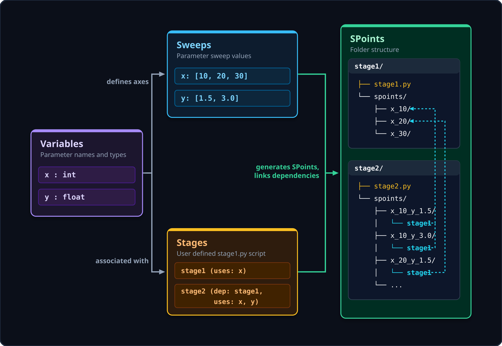

Overview
=============

.. image:: ../workflow_relationship.svg
   :class: only-light
   :align: center
   :width: 100%
   :alt: Workflow Architecture & Relationships

Using **snap_workflow**, a user establishes a framework, or **workflow**, to run systematic computational research by adding three components to the workflow: variables, stages, and sweeps. 

**variable** 
    Any parameter whose values you want to sweep or vary over the course of different runs during computational experiments.

**stage**
    Modular components of your computational pipeline (e.g. mesh generation, numerical solving, rendering, etc.) that run user-defined simulation and collection scripts. Stages can declare dependencies on upstream stages, establishing correct execution order.

**sweep**
    A sweep defines the set of values you want your variables to take across your registered stages. snap_workflow automatically generates all sweep points (SPoints) based on the Cartesian product of these values.

Directory Layout
----------------

A configured workflow initializes a structured, predictable layout:

.. code-block:: text

   my_experiment/
   ├── .workflow/                 # Internal workflow configurations
   ├── params/                    # Static parameter definitions
   ├── stage_A/                   # A modular workflow stage
   │   ├── env.yaml               # Stage environment configuration
   │   ├── simulation.py          # Target simulation script
   │   ├── collect.py             # Script compiling results
   │   └── spoints/               # Auto-generated parameter combinations
   │       └── sweep_1/           
   │           ├── var1_val1_var2_val1/   # An SPoint run directory
   │           └── var1_val1_var2_val2/
   └── stage_B/                   # Downstream stage
       └── spoints/
           └── sweep_1/
               └── var1_val1_var2_val1/
                   └── stage_A/   # Symlink to upstream dependency SPoint data

Upstream Dependency Resolution
------------------------------

When a downstream stage (e.g. ``stage_B``) declares a dependency on an upstream stage (e.g. ``stage_A``), `snap_workflow` automatically creates a relative symbolic link inside each SPoint directory pointing to the corresponding SPoint directory of the upstream stage.

This ensures that downstream simulation scripts can easily read parent stages' output data (e.g. loading ``stage_A/mesh.npy``) without doing manual directory path math.

SPoint Status Lifecycle
-----------------------

Each SPoint progresses through a standard set of states:

1. **initialized**: The directory and parameters exist, but the simulation has not yet run.
2. **running**: The scheduler has launched the script. The script is executing within the `SPoint_Manager` context block.
3. **complete**: The script completed execution successfully (exit code 0).
4. **incomplete**: The simulation run was interrupted (e.g. via keyboard interrupt or scheduler timeout signal) but captured and saved checkpoint progress.
5. **error**: The simulation threw an unhandled exception or failed.
